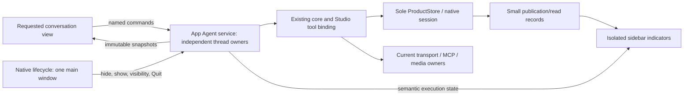

# E11 technical design

State: approved and activated on 2026-10-16; implementation follows the reviewed four-stage plan. Source baseline: `eab6c911` on `codex/agent-mcp-integration`, 2026-10-16. Requirements and acceptance IDs are authoritative in [prd.md](prd.md); ordered work is in [implement.md](implement.md).

## Selected architecture

Retain the sole main WebView and move Agent execution from React page ownership into an application-lifetime Studio service. Closing the desktop window hides that same window; reopening shows it without recreating the document, ProductStore, native session or MCP host. Different conversations have independent owned work inside this application. Explicit Quit ends the application-managed host. Web shares the service for the lifetime of its existing document.

| Option | Reuse and cost | Decision |
| --- | --- | --- |
| Retained main WebView + app service + current Rust resource owners | Reuses the actual creative tools, native HTTP, current credentials, binary materialization, Web Audio, ProductStore session and E10 authority. Requires real hidden-window scheduling evidence on each desktop OS. | Selected for the confirmed window-close lifetime. |
| App-managed Node/other JS runtime | Public core/providers are reusable, but Studio's complete tool binding is not a portable import. Needs new authenticated IPC, lock/credential/reference/transport/media ports, subscription protocol and packaged runtime. A second ProductStore open resets current session authority. | Additional runtime and packaging work is not justified by this lifetime requirement. |
| Rust execution loop or external worker/daemon | Would replace/duplicate the public loop or require a new cross-process protocol, distribution and lifecycle. | Outside E11; does not improve the selected ownership boundary by itself. |

There is one public core loop, one product transaction owner and one desktop product window. No new public core/provider API, runtime binary, Node sidecar, second hidden WebView or persisted execution-permission token is planned. Research and official/pinned native API evidence are in [product boundaries](research/product-execution-boundaries.md) and [native lifetime](research/native-background-and-single-instance.md).

## Ownership and commands

Create the feature-owned service once from app bootstrap after the fixed store and platform services are available. App composition imports the Agent's named entry point; feature runtime/models/commands never import React, router, DOM nodes or private UI hooks. Initialize/reconcile once before fresh dispatch; optimistic UI may publish immediately while initialization is pending. React StrictMode/remount must not create another service or repeat recovery.

Each per-thread invocation owns an opaque token/epoch, immutable submitted intent, reserved thread/run/message identities, its AbortController, feedback controller and original completion promise. Reserve synchronously before the first await. Keep the existing actual `cuepoint:agent:<threadId>` Web Lock capability and transactional run/call predicates: the service map is a local duplicate-send guard, not tool authority or browser cross-tab coordination. Release only the exact entry after its original execution, final flush and publication settle. Another thread is independent; same-thread `runBlocksThread` admission remains enforced.

Expose finite named operations: submit, explicit retry, resolve approval/resume, cancel saved run, check/reconcile uncertain admission, targeted Stop, snapshot/subscribe and shutdown. Each mutation validates explicit thread/run/call identity; targeted Stop additionally matches the current invocation token. Stop A cannot stop B or a later A invocation. Subscription disposal only detaches a reader. Parked approval has no fictional active controller: the saved run blocks competing same-thread admission, while an explicit later decision can establish a fresh owned invocation for that run.

Preserve exact current credentials at dispatch, original frozen tool/permission selection, project/reference ownership and original-result readback. Rejecting an approval remains possible without a working connector. Reattaching, opening a report and checking admission never invoke retry/resume/model/tools. An unknown admission retains its reserved identity and read-only reconciliation; an absent readback is not permission to submit again.

### Submitted content, drafts and presentation

Lift only plain submitted/recovery DTOs from UI into feature models. A small app/document-lifetime draft model retains scoped text, references, import ownership and exact revision; the React hook becomes its adapter. This is in-memory draft continuity, not a durable outbox or restart auto-send feature. Consume/restore uses the existing whole-draft revision contract, so a late A failure cannot overwrite newer edits in A or the draft in B.

The Send gesture still captures content, reserves identities and displays its optimistic message synchronously before asynchronous validation/storage/network. Foreground paint yielding remains bounded; detached/hidden execution must never depend on a React acknowledgement, animation frame or visible DOM. Keep preparation/model validation quiet. Retain failures and uncertain attempts under their original identity even without a subscriber; remount neither loses the result nor repeats a global toast.

First-send creation can navigate only through a still-current view attachment generation. The service records its receipt but does not navigate; finishing A after the user moved to B cannot pull the route back. Each invocation has independent E03 feedback. Public DOM timing acknowledgement remains separate from background receipt and durable unread acknowledgement.

### Generation and native work

Integrate existing named video/audio workers with exact lifecycle handles `{threadId, ownerId, requestStop, done}`; `done` is their original settlement promise. Include the existing narrowly named AI task-wrapup preparation owner (`TaskWrapup.tsx` / `runtime/taskWrapup.ts`), which currently owns another paid request and aborts on unmount. Do not wrap a worker already holding the thread lock in another same-thread lock. Establish mutually exclusive admission between model, task-wrapup and Agent generation owners using the existing actual ownership policy. Their original approval/start remains explicit; subscriptions do not restart queues. Task-wrapup AI preparation no longer counts as a manual pending mutation that prevents navigation; its real manual editing/saving/conflict guards remain. Task-only summary publication does not manufacture a chat-unread message.

Remove Agent-owned pauses from thread/page teardown, including the project-audio teardown that can stop Agent work. Preserve unrelated foreground audio behavior. App Quit also registers the original completion of retained reference imports, desktop import and other accepted native work; an abort boolean is not a drain receipt. Shared MCP connection disposal belongs to whole-app shutdown, never Stop on one conversation.

## Navigation and lifetime

| Event | Required behavior |
| --- | --- |
| Switch A/B, new topic, settings/project route, in-app Back/Forward | Detach/attach views; accepted work, attempts and scoped drafts remain owned. No execution-only leave dialog. |
| Narrow full-width detail/composer overlay | Keep execution; hidden/inert transcript cannot acknowledge unread content. |
| Explicit Stop | Signal only the exact selected owner; retain stopping until actual settlement. |
| Delete/clear | Keep destructive safeguards; stop/drain the exact target and let deletion win late output/read acknowledgements. |
| Desktop window close/minimize | Retain main document, service, store/session and native resources; hide/minimize is not document unload. |
| Reopen/repeated launch | Show/unminimize/focus the existing main, without a fresh store open or recovery/resubmit. |
| Explicit application Quit | Close admission, stop/drain original work, dispose shared resources, then exit. |
| Crash/reload/next cold startup | New service session, conservative local reconciliation, zero automatic external-effect replay. |
| Browser document ends | Existing transport teardown/recovery boundary; no tab-close execution promise. |

Remove `useThreadDeparture`'s execution-only blocker/modal and the actual abort/pause paths in page selection, new-thread handlers and execution-hook cleanup after the app service owns them. Preserve requested-topic query envelopes, stale-read rejection, manual business-editor drafts, pending mutations/conflict protection and destructive confirmations. Closing the sole desktop window hides those drafts with the retained document rather than discarding them. Existing dirty-editor protection also applies before an irreversible application Quit.

## Native single instance and background application

Use the actual profile's private fixed app-data directory. Acquire a non-truncating `std::fs::File::try_lock` before creating main or opening product storage; hold its original file descriptor through hidden running and Quit cleanup. The existing Rust 1.99 toolchain supports this API. A normal profile and an explicitly isolated profile are independent roots; paths/lock identity are not supplied by arbitrary launch arguments. Never unlink/recreate a held lock. Real lock/setup errors fail closed before product admission.

The primary binds an ephemeral `127.0.0.1` TCP listener using existing Tokio and atomically publishes private activation metadata (port, fresh nonce, protocol version). A contender that cannot acquire the lock only attempts activation and exits; lost metadata/activation cannot fall through to create another window or store. Handle the initial lock-to-listener race with bounded readiness retry, and replace stale metadata only after acquiring the lock following a dead owner.

Activation is one bounded JSON-line frame, at most 256 bytes, with exact fields/version/action `activate`/nonce. Allow at most eight concurrent activation connections, a one-second connect/read deadline per attempt and a three-second total startup-readiness retry budget. Reply with a fixed versioned `accepted`/`closing`/`not_ready` acknowledgement; accepted means the native show/focus request was admitted, not a product action. It only requests Show/Unminimize/Focus on the existing main. It carries no cwd/path/URL/JS/model/tool payload and cannot navigate or invoke product commands. Keep the port/nonce in private app data and do not expose a frontend HTTP API or alter browser CORS/CSP. A primary already quitting never reopens admission or constructs a replacement main.

Install a native tray/menu with Open and Quit before enabling close-to-hide. macOS Dock `Reopen` and platform app entry show the same window; Windows tray/app reactivation does likewise. Lifecycle setup failure must leave a visible actionable error rather than an unreachable hidden app. Native code owns these APIs; do not grant a generic renderer shell/window/tray capability.

On supported macOS, configure the pinned WKWebView inactive scheduling policy for background execution. Do not explicitly suspend WebView2 on Windows. Neither settings nor a surviving process prove actual JS/network/tool progress. Host progress cannot require animation frames or foreground timers. Expose native visible/focused state through a small typed platform port so read acknowledgements stop while the retained window is hidden.

### Explicit Quit protocol

One native coordinator owns `running -> checking_drafts -> quiescing -> exiting`, the quit-intent ID and original completion. Repeated Quit joins it; final `AppHandle::exit` must pass the final exit callback without recursively initiating another shutdown. A closed lifecycle DTO binds the real bundled main sender, actual session generation and original quit intent. Status/acknowledgement cannot be reconstructed from saved IDs or used as a quit-now bypass. The current manual guard only exposes router/local/beforeunload entry points; add a small app-owned registration/aggregate Quit request for its actual dirty/pending/conflict owners, including overlays. Do not assume native exit can be vetoed by browser beforeunload. Tray/Dock Quit shows/focuses the sole main when that existing editor guard needs a decision; a responsive guard may await that human decision and cancellation returns to running before shutdown admission closes. The initial renderer guard-status response has a one-second native timeout: an absent/unresponsive frontend enters the same bounded shutdown rather than waiting forever before quiescing. Do not fabricate a saved-draft or user-confirmation receipt in that fallback.

1. After existing dirty-editor protection resolves, synchronously close JS service admission and native **new-effect** admission. Add a distinct finite action gate/quiescing state; current Rust MCP `close_admission` and JS connection `dispose` retire the host and cannot be reused as this gate. Reject fresh prepare/invoke/connect/login/import work while preserving exact original Stop/status/readback and product checkpoint/ledger/publication writes. Do not blanket-deny the product request channel needed to finish those writes. Late compatibility/import callbacks cannot admit new work after this point.
2. Signal all current model/generation/import owners, retain their original `done` promises and let original result/checkpoint/unknown publications finish while ProductStore and the exact MCP host are still available.
3. Dispose shared MCP and native resource owners after their original Stop/readback publication paths, then close storage. In particular, do not call `clearMcpHostServices` first: the current closed host would reject the original invocation's Stop/status and prevent honest settlement.
4. Use one 5-second cooperative grace after guard resolution for the original quit intent, followed by at most two seconds total native forced cleanup; repeated Quit does not reset either deadline and per-resource waits cannot multiply the budget. If JS/drain does not settle, exit without claiming drained, remote cancellation, rollback or confirmed result. Preserve whatever certainty was durably established; next startup conservatively reconciles unfinished work. No new general “leave conversation” prompt is introduced.

Actual document destruction/reload continues to invalidate current native authority. Closing/hiding does not synthesize pagehide/unload. No promise extends to OS sleep, forced process termination or execution after application Quit.

## Durable unread and small sidebar projection

Use the existing `deviceSettings` table with one strict typed activity record per thread. Ordinary assistant output uses monotonic `publicRevision` and `readRevision`; its message/public activity snapshot carries the accepted publication revision. No new table/index/schema version or historical backfill is required. Do not persist a second execution authority: running comes from the live app owner, combined with reconciled saved approval/attention state.

Use a namespaced SHA-256 of the UTF-8 encoding of `JSON.stringify(threadId)` for the bounded setting key, validate the exact original thread ID in its value, and prepare/cache that key **before** entering a product write transaction. This handles the currently accepted broad IDs and isolated UTF-16 surrogates without introducing crypto awaits inside Dexie transactions. Use strict typed reads; the forgiving settings getter cannot turn a read/parse error into “all read.” Fresh missing state is distinct from failed/corrupt state.

Publish at the actual checkpoint/activity/approval/sole-terminal/result writers, atomically with their source rows, expanding every initiating transaction's table scope to include `deviceSettings`. Meaningful assistant output/reasoning, public activity, approval and accepted terminal/error transitions advance the ordinary cursor; empty placeholders, user admission, title/model changes, metrics, internal phases and identical/no-op publication do not. Repeated settlement does not produce another unread transition.

Late E07/E10 reports can update an older message after a later conversation turn is visible. Keep their exact report cursors separately inside the same small record, bounded by the existing 128 jobs/thread quota: `{jobId, assistantMessageId, publicRevision, readRevision}`. Reuse the accepted `job.revision`; progress-only changes do not publish unread. Publish from `publishAgentJob` and direct unknown recovery, not a React query. A normal transcript-tail ack cannot consume an unseen older report. Its actual public summary/report acknowledges `{threadId, jobId, observedRevision}` only when displayed. Explicit result clear/delete removes that cursor under the existing exact owner checks; late output cannot recreate it.

For ordinary content, `acknowledgeThreadRead({threadId, observedRevision})` checks exact surviving ownership and safe revision bounds in one transaction, then writes `max(existingRead, observedRevision)` only if changed. Rendering 41 then receiving 42 before ack must leave 42 unread. Report acknowledgement applies that same rule to its exact surviving job/result. Deletion always wins; neither acknowledgement recreates rows. Sidebar unread is ordinary unread OR any unread report.

### Read eligibility and rendering

Deliver a feature-owned immutable read envelope from one authoritative read transaction containing the requested-thread identity, exact publication revision and matching message/current public activity needed to render it. Subscribe to that full streaming envelope at the transcript-reader boundary, not AgentChatPage/composer/root; those higher owners consume stable semantic commands/state. Do not combine stale message/run query data with a separately queried latest revision. E07 report envelopes similarly carry the accepted body/result revision. Preserve existing stale requested-topic guards and avoid expanding this into a generic query framework rewrite.

The local MessageList ordinary-tail probe acknowledges only a successfully painted matching snapshot, current attachment generation, visible/focused native window/document, non-hidden/non-inert transcript and actual visible latest public item while following. Scroll-up, hidden window, full-width detail, expanded composer or covering navigation overlay is ineligible for tail acknowledgement. The auto-follow 300px threshold alone is not evidence of visibility. A report probe instead requires its own exact accepted revision/body or meaningful result summary to be visible under those same window/surface guards; it may acknowledge a historical report while the user scrolls up without following the tail, and clears only that report. A generic “查看报告” button or job title is not the result summary. Where the current collapsed web/MCP report has only that button, require an actual revision-matched summary or expanded report body. Expanding a result whose meaningful summary was already visible is not required.

Coalesce only the maximum revision already observed eligible, with one ack in flight. A valid captured A ack may finish after switching to B, but cannot substitute a newer A revision. Public-output timing and unread are separate consumers of shared visibility helpers, not the same once-per-invocation hook.

At each topic row, cache/equality-compare `busy`, `waitingApproval`, `unread` and relevant owner identity before notifying React. Subscribe to the small per-thread activity record and semantic host state, preserving the real browser Dexie/native observation lanes. Token/checkpoint revisions may commit frequently but cannot cause root/sidebar/all-row rerenders when those semantics stay unchanged. Memoize the navigation/row boundary and stabilize callbacks; active transcript updates must not defeat this isolation.

Reserve a trailing fixed status area with a small hollow CSS spinner and a separate unread dot. They can coexist; rename/delete/time layout cannot overlap them at wide/narrow widths. Busy includes actual executing/stopping owners, not stale `running` records or a parked approval. Preserve existing approval affordances; no forever-spinner for a pending human decision. Keep sibling action buttons, keyboard navigation, accessible state text and reduced motion without per-token live announcements. Apply the same component to normal, loading/unavailable and narrow/task-board navigation entry paths.

## Footprint, delivery and rollback

This plan adds no runtime binary or new singleton crate. Enable the native Tauri tray feature using its existing dependency closure; actual linked/installer size remains unmeasured and belongs to the owner's final packaging batch. Do not substitute compressed source-crate size or this machine's Node binary size for package impact. Keep `desktop.rs` as composition; feature lifecycle modules own lock/activation/Quit behavior.

Four source stages and their acceptance/rollback points are in [implement.md](implement.md). Each receives necessary affected checks, changed-scope review and a local commit before continuing. No push, full regression, whole-app build, installer or paid/live service sweep is included per stage. Final task review spans all E11 changed packages; deferred full/installed gates remain explicit in the parent epic.

Native hidden-progress feasibility must be checked early in the native stage with the actual retained WebView, two controlled external operations and a tool/generation boundary for longer than six minutes. Available macOS evidence and pending Windows/installed evidence must be reported separately. If either supported host fails the required behavior, reopen this architecture decision before claiming background delivery; do not silently narrow Windows support or add an unreviewed runtime. No implementation or platform success is established by these planning documents.

Rollback uses reviewed local commits, never destructive reset of unrelated work. The service stage precedes removal of navigation cancellation. Restore the native close-to-hide path and its same-stage Quit/activation changes together if native lifetime fails; do not restore a UI abort shortcut as a substitute for correct ownership. Fresh typed metadata needs no legacy migration; do not add old-data upgrade branches.
