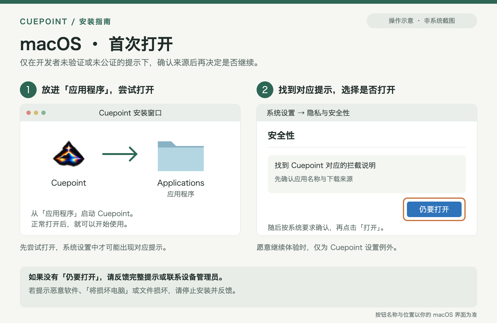
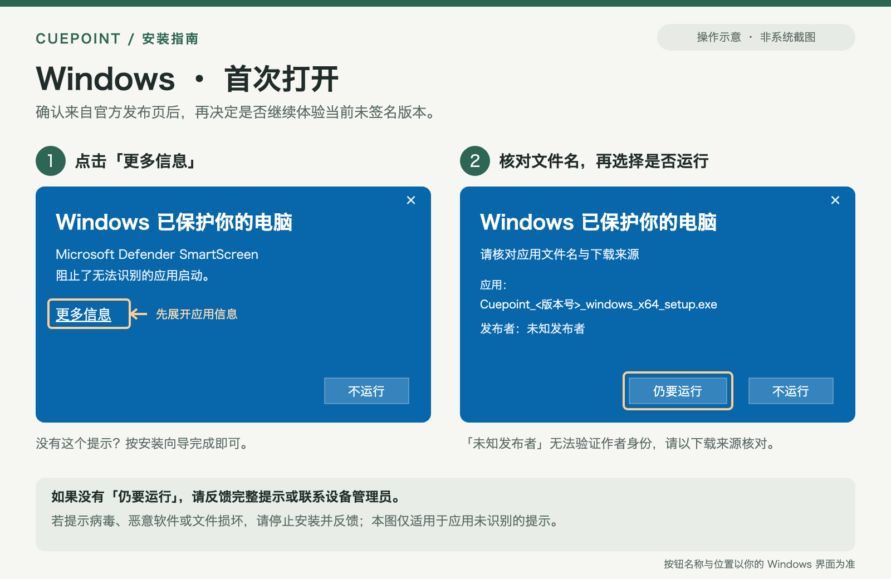

# Cuepoint 桌面版安装与首次打开

从 [Cuepoint 官方 GitHub Releases](https://github.com/ROYIANS/Cuepoint/releases) 下载，按下面的说明选择安装包。当前桌面版以早期体验版本分发；安装完成后，应用名称为 **Cuepoint**，窗口标题为 **小光点 Cuepoint**。

## 首次打开前，先了解系统提示

目前 Windows 安装包尚未进行代码签名，macOS 版本使用临时签名，尚未完成 Developer ID 签名和 Apple 公证。因此，首次安装或打开时**可能**出现“Windows 已保护你的电脑”“无法验证开发者”或“Apple 无法检查是否包含恶意软件”等提示。不同系统版本、设备设置和安全策略下，界面可能不同。

遇到这些提示时，不用急着点击：先确认你下载的是本项目官方 Release 的对应文件，再决定是否继续。下面会说明具体操作。

我们提供公开源码、发布文件校验值和安装说明，方便你了解和核对下载内容。源码公开或校验值一致，都不能单独保证程序绝对安全。**如果提示病毒、恶意软件、“将损坏你的电脑”或“文件已损坏”，请停止安装并反馈；不要按身份验证提示的步骤强行打开。**

## 1. 下载适合你的安装包

1. 打开 [官方 Releases](https://github.com/ROYIANS/Cuepoint/releases)，选择桌面版本；桌面版本的标签形如 `desktop-v<版本号>`。标有 **Pre-release** 的版本表示预发布体验版。
2. 阅读该版本的说明，展开页面底部的 **Assets**（发布文件）。
3. 按下表下载一个对应安装包。`<版本号>` 表示该次发布的数字版本，例如 `0.1.0`；实际文件名中没有尖括号。

| 你的设备 | 下载文件 | 使用要求 |
| --- | --- | --- |
| Mac，Apple 芯片（M 系列） | `Cuepoint_<版本号>_macos_arm64.dmg` | macOS 14 或更新版本 |
| Mac，Intel 处理器 | `Cuepoint_<版本号>_macos_x64.dmg` | macOS 14 或更新版本 |
| Windows，x64 处理器 | `Cuepoint_<版本号>_windows_x64_setup.exe` | 64 位 x64 Windows；需要 WebView2 |
| Linux，x64，Debian / Ubuntu 系发行版 | `Cuepoint_<版本号>_linux_x64.deb` | Ubuntu 22.04 构建基线；运行依赖需满足 |
| Linux，x64，选择 AppImage 形式 | `Cuepoint_<版本号>_linux_x64.AppImage` | 需要兼容的运行依赖，部分环境需要 FUSE |

**不知道自己是哪一种设备？**

- **Mac**：点击左上角 Apple 菜单 → **关于本机**。显示“芯片：Apple M…”选 `arm64`；显示“处理器：Intel…”选 `x64`。
- **Windows**：打开 **设置 → 系统 → 系统信息（关于）**，查看“系统类型”。“基于 x64 的处理器”选 `windows_x64`；只有“64 位”字样还不足以区分 x64 与 ARM。
- **Linux**：可以在终端输入 `uname -m`；结果为 `x86_64` 时对应此处的 x64 安装包。

当前没有 Windows ARM、Linux ARM 或 macOS 通用安装包。不要给 ARM Windows 或 ARM Linux 下载 x64 包来作为原生安装包使用。

Assets 中的 **Source code (zip)** / **Source code (tar.gz)** 是源码，不是桌面安装包。`SHA256SUMS` 用于核对下载文件，`release-manifest.json` 是发布记录，两者也无需双击安装。如果还没有适合设备的安装包，请等待对应版本发布。

<details>
<summary>可选：用 SHA-256 核对下载文件</summary>

从**同一个 Release** 的 Assets 下载 `SHA256SUMS`，用文本编辑器打开。找到与你下载的安装包同名的一行，比较其中的 64 位 SHA-256 值。

在 Windows 的 PowerShell 中执行下列命令，把文件名中的 `0.1.0` 改成实际版本；如果你保存到了其他目录，也要修改路径：

```powershell
Get-FileHash -Algorithm SHA256 -LiteralPath "$env:USERPROFILE\Downloads\Cuepoint_0.1.0_windows_x64_setup.exe"
```

在 Mac 的“终端”中执行下列命令，修改版本号；Intel Mac 将 `arm64` 改为 `x64`，保存到其他目录时修改路径：

```sh
shasum -a 256 "$HOME/Downloads/Cuepoint_0.1.0_macos_arm64.dmg"
```

比较时忽略字母大小写。哈希值一致，表示文件内容与发布页列出的内容一致；它不证明软件没有安全问题。**如果不一致，停止安装，重新从官方 Release 下载；仍不一致时请反馈。**

</details>

## 2. macOS：安装与首次打开

1. 双击下载的 `.dmg` 文件。
2. 在打开的窗口中，将 **Cuepoint** 拖入 **Applications（应用程序）** 文件夹。
3. 打开“应用程序”文件夹，从那里启动 **Cuepoint**。随后可以推出安装用的 DMG 磁盘。
4. 如果正常打开，就可以开始使用。如果出现开发者身份无法验证、未公证或 Apple 无法检查恶意软件的提示，先关闭该提示，按下面的步骤核对后再决定。

确认 DMG 来自上面的官方 Release，且版本和设备架构正确；愿意继续体验时：

1. 在刚才尝试打开 Cuepoint 之后，打开 **系统设置 → 隐私与安全性**。
2. 向下滚动，找到与 **Cuepoint** 对应的拦截说明，点击 **仍要打开**。
3. 根据系统要求完成身份确认；警告再次出现时，确认显示的应用是 Cuepoint，再点击 **打开**。



*图为操作示意，不是系统截图；按钮名称和位置请以你的 macOS 界面为准。*

如果找不到对应的 **仍要打开** 按钮，或电脑由公司、学校管理，请联系管理员或向项目反馈具体提示。无需关闭 Gatekeeper 或修改系统安全策略。

## 3. Windows：安装与首次运行

1. 双击下载的 `Cuepoint_<版本号>_windows_x64_setup.exe`。
2. 如果安装向导正常出现，按提示完成安装；当前安装包按当前用户安装。
3. 从开始菜单打开 **Cuepoint**。

如果出现 **Windows 已保护你的电脑**：

1. 点击 **更多信息**，查看应用文件名。
2. 核对文件名是否与你从官方 Release 下载的 `Cuepoint_<版本号>_windows_x64_setup.exe` 一致。当前包未签名，发布者可能显示为 **未知发布者**；这个字样无法验证作者身份。
3. 确认下载来源、版本和文件名，愿意继续体验时，再点击 **仍要运行**，进入安装向导。



*图为操作示意，不是系统截图；按钮名称和位置请以你的 Windows 界面为准。*

如果没有 **仍要运行**，可能受到组织策略或 Windows 的 Smart App Control（智能应用控制）等设置限制。请联系管理员，或向项目反馈完整提示；本指南不要求你关闭 Defender、SmartScreen 或智能应用控制。

**安装过程中需要联网吗？** Cuepoint 需要 Microsoft WebView2 运行时。如果电脑中缺少它，安装器会下载其引导安装程序，因此该次安装需要网络连接。如果这个步骤失败，请保留具体报错并反馈。

桌面应用的文件工作区要求位于本机 **NTFS** 文件系统。遇到工作区或存储错误时，请反馈路径和错误信息；不要把数据目录直接改到网盘同步目录。

## 4. Linux：选择 DEB 或 AppImage

当前 Linux 包面向 x64，以 Ubuntu 22.04 为构建基线；其他发行版是否满足依赖，需要在对应设备上确认。

- **DEB**：使用发行版提供的软件安装器打开 `.deb` 文件，按提示安装，再从应用菜单启动 Cuepoint。
- **AppImage**：在文件管理器的“属性 / 权限”中允许该文件作为程序执行，再打开 `.AppImage` 文件；具体选项名称因桌面环境而异。

Linux 需要兼容的 WebKitGTK / GStreamer 等运行依赖。AppImage 也可能受 FUSE、编解码器或音频环境影响。如果提示缺少依赖或无法启动，请反馈发行版、版本和完整报错，不必尝试随机安装网上的依赖集合。

## 5. 后续更新与项目备份

当前版本**没有内置自动更新**。有新版本时，回到 [官方 Releases](https://github.com/ROYIANS/Cuepoint/releases) 阅读说明，手动下载对应安装包，并按该版本说明更新。

更新前，先从项目菜单导出需要保留的**项目 ZIP**，将文件另存为备份，再退出 Cuepoint。项目 ZIP 的范围见 [README 的备份说明](../README.md#项目-zip-的范围)；它并不包含整个工作室、全部连接与 API Key 或完整聊天历史。

桌面版和浏览器版的数据各自保存，目前不会自动同步。换设备、换运行方式前，也请先导出项目 ZIP。

## 遇到问题时，提供这些信息

可以通过 [GitHub Issues](https://github.com/ROYIANS/Cuepoint/issues) 反馈：

- 系统版本，以及 Apple 芯片 / Intel / x64 等设备信息。
- Release 版本、下载的完整文件名，以及是否从官方 Release 下载。
- 停在哪一步、提示的完整文字，必要时附上截图；截图请隐藏私人信息和 API Key。
- 如果核对过 SHA-256，说明是否与 `SHA256SUMS` 一致。

安全提示的系统说明可参考 [Apple：在 Mac 上安全地打开 App](https://support.apple.com/zh-cn/102445) 和 [Microsoft：SmartScreen 软件信誉说明](https://learn.microsoft.com/en-us/windows/apps/package-and-deploy/smartscreen-reputation)。开发者的打包与分发约定见 [桌面分发说明](desktop-distribution.md)。
